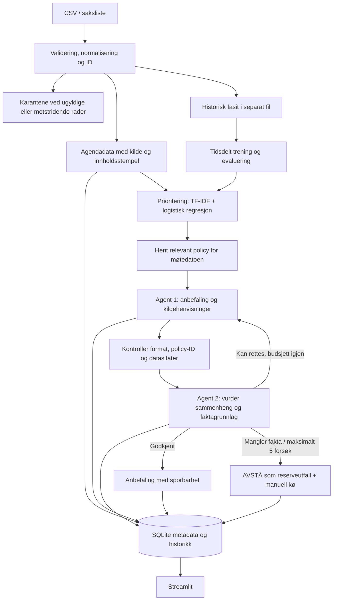

# Hackathon_NBIM_2026

Lokal prototype som leser generalforsamlingssaker, kontrollerer datakvalitet,
prioriterer arbeidskøen og lager sporbare stemmeanbefalinger med kontrollagent.
Ingen stemmer sendes til NBIM eller en generalforsamling.

## Kjør med én kommando

Krever Python 3.11+ og internett ved første installasjon. Kjør fra repoet:

```bash
python3 run.py
```

På Windows: `py run.py`. Programmet oppretter `.venv`, installerer bibliotekene
og åpner Streamlit. Dashboardet starter med fire tydelig syntetiske demoeksempler,
uten API-nøkkel eller eksterne modellkall. Velg **NBIM-data** for de faktiske
historiske radene. Notebooken `src/data_investigation.ipynb` er bevart.

Reproduser datakontroll, modellresultater, syntetisk agentflyt, motstandstest og
kontroll av at andre kjøring gjenbruker resultatene:

```bash
python3 run.py --demo
```

Se `artifacts/demo_report.json`, `artifacts/model/report.json` og
`artifacts/processed/{real,npx}/`. Kjør tester med `python3 run.py --check`.
Første installasjon tar lengre tid; senere kjøringer bruker det lokale miljøet.
For manuelt oppsett: `python3 -m venv .venv`, aktiver miljøet, deretter
`python -m pip install -r requirements.txt` og `python -m streamlit run app.py`.
`requirements-lock.txt` dokumenterer de eksakte pakkene brukt ved verifikasjon
med Python 3.13 på macOS; normal oppstart bruker kompatibilitetsintervallene i
`requirements.txt` slik at også andre plattformer kan installere.

## Dataflyten



1. Råfilene endres ikke. Hver import får filhash og versjonert kvalitetsrapport.
   Sakens ID bygges fra **kilde + meeting_id + item_no**. Like tekster kan være
   forskjellige saker; de slås ikke sammen. Identiske rader dedupliseres,
   motstridende varianter av samme ID havner i karantene.
2. `records.jsonl` inneholder kun tillatte fakta som fantes før avstemningen.
   `labels.jsonl` inneholder historisk fasit og kvalitetsflagg separat.
   `rationale_text`, `nbim_vote`, `against_board`, `position_paper` og lignende
   går ikke til modell eller agenter. `proposal_type` brukes heller ikke.
3. Logistisk regresjon gir en **køprioritet**, ikke en godkjent stemme. Alle
   saker beholdes. Sannsynlighetsscorene er ukalibrerte. Valgfri klyngeanalyse
   grupperer lignende sakstekster og påvirker ikke stemmegivningen.
4. En liten, datert policybase hentes med transparent ordmatching. Agenten må
   sitere både en lokal policytekst og den konkrete forslagsteksten. Referansen
   viser den offisielle PDF-en og sidetall/punkt. Policytekstene er **kuraterte
   parafraser**, ikke direkte sitater fra originalen.
5. I LLM-modus gjør kontrollagenten et separat modellkall og vurderer om
   konklusjonen følger av kildene. De faste kildekontrollene kjøres først.
   Godkjenning er ingen garanti; samme modell kan gjøre samme feil i begge roller.
6. Maksimalt **5 totale vurderingsforsøk = 4 retries** per sak/versjon. Manglende
   fakta og policy gir tidlig overlevering, siden gjentakelse ikke skaper nye fakta.
   Reserveutfallet `AVSTÅ` har alltid `needs_human_review=true` og en eksplisitt
   `fallback_type`. Det skilles fra en begrunnet, kontrollert avstå-anbefaling.

## Hva dataene og modellen faktisk viser

| | NBIM-fil (`real`) | N-PX-fil (`npx`) |
|---|---:|---:|
| Rader | 13 757 | 52 906 |
| Ukjent stemmeetikett | 334 | 3 014 |
| Tom forslagstekst | 0 | 7 |

N-PX-forvalterens identitet og labelproveniens er ikke dokumentert i filen.
Kolonnenavnet `nbim_vote` gjør ikke N-PX-stemmene til NBIM-fasit. Modellene
trenes separat per kilde; dashboardet bruker NBIM-filen til historisk evaluering.
`WITHHOLD` grupperes med MOT for klassifisering, men råverdien bevares.
Frekvensvalg som `One Year`, `NONE` og `Do Not Vote` blir ukjente, aldri automatisk AVSTÅ.

Første NBIM-modell: trening 2019–2024, validering 2025 og holdout 2026 til og
med 30. september. Kun `proposal_text` brukes som treningsfeature.

| 2026-resultat | MOT-presisjon | MOT-recall | MOT-F1 |
|---|---:|---:|---:|
| Logistisk stemmeprediksjon, alle 1 542 kjente labels | 18,00 % | 54,55 % | 27,07 % |
| Følg faktisk styreanbefaling, 1 539 tilgjengelige | 57,14 % | 12,12 % | 20,00 % |

Rapporten inneholder også modellresultat på **samme 1 539 saker** for direkte
sammenligning, en alltid-FOR-baseline og forvekslingsmatriser.
Køterskelen velges kun på 2025-data for minst 80 % recall. På holdout fanger
prioritetskøen 78,79 % av MOT-sakene og omfatter 42,74 % av sakene, med 7,89 %
presisjon. Dette dokumenterer prioritering, ikke en bevist reduksjon i manuell
arbeidstid eller færre nødvendige agentkall.

Se [datagjennomgangen](docs/DATA_REVIEW.md) og
[modellresultatene](docs/MODEL_RESULTS.md) for mer detaljer.
**Dette er evaluering av den historiske tekstmodellen. LLM-agentenes semantiske
nøyaktighet er ikke målt med disse tallene.**

## LLM-modus

Kopier `.env.example` til `.env`, og fyll inn `OPENAI_API_KEY` og `OPENAI_MODEL`.
Velg en tilgjengelig modell som støtter Responses API og Structured Outputs.
`OPENAI_REVIEWER_MODEL` kan velge en annen kontrollmodell; ellers brukes samme
modell i et separat kall. API-nøkkelen logges ikke. Bruk gjerne eksplisitte
modellversjoner fremfor aliaser når dere trenger stabil gjenbruk.

Velg deretter LLM-modus eksplisitt i dashboardet. Sakstekst og relevante
policyparafraser sendes til OpenAI når batchen startes; SDK-kall bruker
`store=False`, ingen verktøytilgang og ingen skjulte SDK-retries. Batchgrensen
er 20 som standard og maks 100 i dashboardet. Egne modellkostnader tilkommer.

**Policydekningen er foreløpig begrenset til et utvalg fra 2025**, med et
konservativt datovindu 17. februar–31. desember. Dette er en prototypeavgrensning,
ikke en påstand om offisiell ikrafttredelse. Andre år og udekkede temaer rutes
til manuell vurdering. Saker med bare «velg styremedlem» eller «godkjenn revisor»
mangler ofte fakta om uavhengighet, honorarer og egnethet. Begge agentene er
instruert til å overlevere slike saker fremfor å finne på selskapsopplysninger.

## Kommandolinje etter installasjon

Bruk `.venv/bin/python` i stedet for `python` dersom miljøet ikke er aktivert.

```bash
python -m nbim_flow prepare --source real
python -m nbim_flow prepare --source npx
python -m nbim_flow train --source real
python -m nbim_flow train --source real --clusters 4 --out artifacts/model_clusters
python -m nbim_flow process --source upload --input data/demo_agenda.csv
python -m nbim_flow process --source real --year 2025 --mode llm --limit 20
python -m nbim_flow evaluate --source real --mode llm
python -m nbim_flow attack-test
```

`evaluate` sammenligner lagrede anbefalinger med separat fasit og oppgir
dekning, manuelle saker og reserveutfall. Dette er et valgt utvalg av behandlede
saker, ikke automatisk en representativ holdout-test. Demo og LLM blandes ikke.
For neste reelle eksperiment: lås policy, prompts og modeller, velg et fast sett
nyere møter, og kjør hele agentflyten før dere ser på fasiten.

## Watermark og metadata

`record_id` identifiserer saken; `evidence_hash` identifiserer versjonen av
faktagrunnlaget. `run_key` kombinerer faktagrunnlaget med policyhash,
kode-/prompthash, agentmodeller, modus og konfidenskrav. Nye rader kjøres, uendrede
resultater gjenbrukes. Endring i historisk fasit, prioriteringsmodell eller
forsøksbudsjett utløser ikke nye agentkall for ferdige saker. Ny policy, nye
fakta eller ny beslutningskode/modell lager en ny versjon og bevarer historikken.
Et eksternt modellalias kan endres uten at navnet endres; bruk eksplisitte
versjoner eller endre pipelineversjonen for å revurdere slike resultater.

SQLite lagrer inputversjon, kilde, modell-/policyversjoner, start, forslag,
kildekontroll, kontrollagentens svar, antall forsøk/retries, tokenbruk når
tilgjengelig og sluttstatus. Sluttresultat og sluttlogg lagres i samme transaksjon.
En atomisk lås hindrer samtidig behandling av samme versjon. Etter prosesskrasj
utløper låsen etter 10 minutter; gjenopptakelse beholder allerede brukte forsøk.
API-feil vises separat og kan forsøkes igjen innenfor gjenværende budsjett.
Metadataene er en lokal revisjonslogg, ikke et manipulasjonssikkert arkiv.

## Motstandstest og videre arbeid

`attack-test` legger en eksplisitt instruksjon i en syntetisk forslagstekst og
verifiserer at den sendes til manuell vurdering uten agentkall. Testresultatet
lagres ærlig som **offline sikkerhetsruting**, ikke som bevis for at en LLM tåler
alle prompt-injection-angrep. Testene dekker også oppdiktede sitater, ugyldige
policy-ID-er, maks fem forsøk, revisjon, API-feil, datofeil og gjenbruk.

Neste arbeid med størst verdi er å dokumentere rådatakildene og N-PX-forvalteren,
legge inn komplette daterte NBIM-policyer, hente selskapsdokumentasjon med
publiseringsdato og kildeavsnitt, og evaluere hele LLM-flyten på et låst sett møter.
En ekstra agent alene løser ikke manglende faktagrunnlag eller felles modellfeil.
Klynger er valgfri utforskning; ingen vektordatabase, Docker, Redis eller
ekstern database er nødvendig for prototypen.

## Kilder og verktøy

- [NBIM Voting](https://www.nbim.no/en/responsible-investment/voting/)
- [NBIMs stemmehistorikk](https://www.nbim.no/en/responsible-investment/voting/our-voting-records/)
- [NBIM Global voting guidelines 2025](https://www.nbim.no/contentassets/01a7ee19b5d84a73a67a365e76a0fb01/global-voting-guildeines_2025.pdf)
- [SEC Form N-PX](https://www.sec.gov/forms/formn-px.pdf)
- [scikit-learn LogisticRegression](https://scikit-learn.org/stable/modules/generated/sklearn.linear_model.LogisticRegression.html)
- [LangGraph Graph API](https://docs.langchain.com/oss/python/langgraph/graph-api)
- [Streamlit](https://docs.streamlit.io/get-started/installation)
- [OpenAI Structured Outputs](https://developers.openai.com/api/docs/guides/structured-outputs)

De lokale CSV-filene er levert av teamet; eksportmetode og opprinnelig URL per
rad følger ikke med. Filhash gir sporbarhet til filen, men beviser ikke autentisitet.
`data/demo_agenda.csv` er syntetisk. AI-bruk: Codex ble brukt til datagjennomgang,
arkitektur, kode, dokumentasjon og tester. Koden bruker Python-standardbiblioteket,
Streamlit, scikit-learn, LangGraph og valgfritt OpenAI SDK. Teamet må gjennomgå
policyfortolkning og rapporterte begrensninger før videre bruk.
