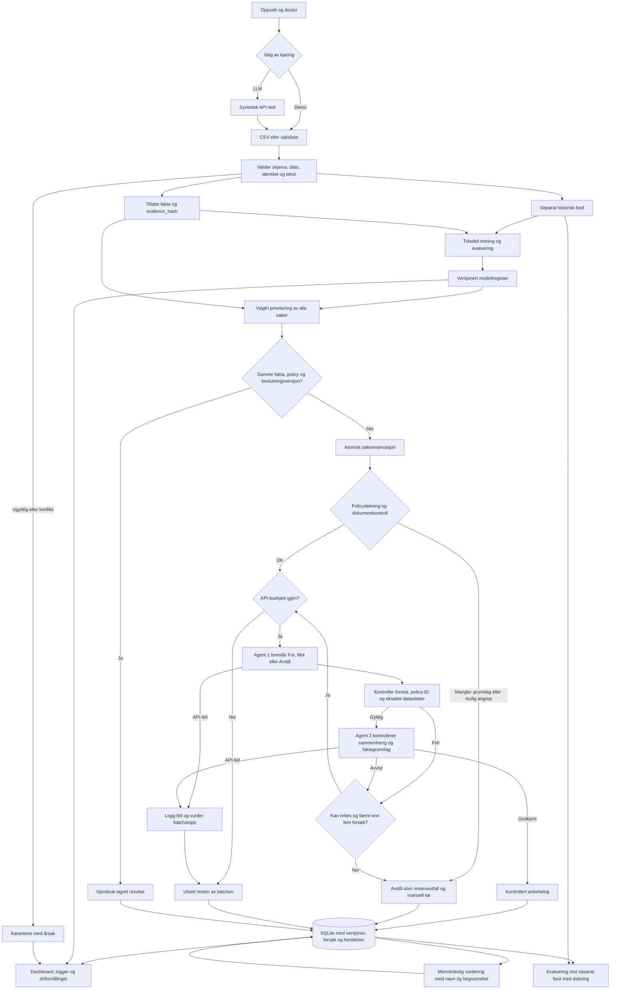

# Hele arbeidsflyten

Diagrammet viser både trening, ekte modellkjøring, gjenbruk og manuell oppfølging.
LLM-agentene kan kjøre lokalt via Ollama; OpenAI er et eksplisitt alternativ.

Mermaid-kilden kan også lastes ned fra Workflow-siden eller skrives ut med
`python3 run.py --cli workflow`.

En vellykket tilkoblingstest betyr ikke at stemmen er riktig. Kontrollagenten kan
avvise en teknisk gyldig anbefaling. Oppbrukt API-budsjett utsetter behandling;
manglende fakta gir en synlig manuell kø. Ingen stemme sendes eksternt.
